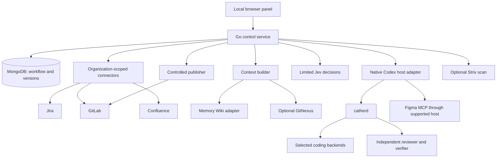

# برنامهٔ ساخت پلتفرم محلی اتوماسیون توسعه با AI

تاریخ: ۱۳ اکتبر ۲۰۲۶ · وضعیت: طرح اجرایی بر پایهٔ R&D و یک پایلوت محدود؛ محصول هنوز ساخته نشده است.

## ۱. تصمیم محصول

پیشنهاد من ساخت **یک پنل و کنترل‌کنندهٔ محلی روی موتورهای موجود** است. بخش اختصاصی، اتصال سازمان‌ها، سیاست اجرای کار، وضعیت قابل بازیابی، پرسش از کاربر و جمع‌آوری شواهد را مدیریت می‌کند. کدنویسی، تقسیم نقش و انتخاب مدل به catherd سپرده می‌شود. برای دانش از Memory Wiki آماده استفاده می‌کنیم؛ برای اتصال سرویس‌ها از MCPهای آماده.

OpenClaw و Hermes اجزای زیادی از نیاز را دارند، اما نصب آن‌ها به‌تنهایی تضمین نمی‌کند تسک Jira به ریپوی درست، داک معتبر، طراحی درست و MR قابل merge تبدیل شود. با انتخاب پنل اختصاصی، تنظیم کامل catherd و پشتیبانی چند سازمان، یک لایهٔ اختصاصی توجیه دارد. ساخت coding engine، مدل تصمیم یا موتور جست‌وجوی دانش از صفر در نسخهٔ اول توجیه ندارد. این نتیجه، تصمیم معماری پس از تغییر خواستهٔ UI است؛ گزارش پایلوت قبلی بر مبنای امکان استفاده از برد آماده نوشته شده بود.

**وعدهٔ محصول:** کاربر سازمان و پروژه را معرفی می‌کند، مدل‌ها و قواعد را تنظیم می‌کند، و سیستم کارهای واجد شرایط را تا MR دارای تست، review مستقل و وضعیت CI جلو می‌برد. وقتی اطلاعات یا توان اجرای معتبر کافی نباشد، یک درخواست روشن در Inbox ثبت می‌شود. merge نهایی در نسخهٔ اول با کاربر است.

### تصمیم‌های تثبیت‌شده

| موضوع | تصمیم |
|---|---|
| اجرا | روی سیستم شخصی، پنل داخل مرورگر محلی؛ ابتدا macOS |
| بک‌اند | Go، net/http، goroutine |
| دادهٔ محصول | MongoDB؛ پایگاه دادهٔ داخلی موتورهای آماده بازنویسی نمی‌شود |
| UI | React، TypeScript، Vite، Tailwind و shadcn/ui خام |
| مرجع طراحی | پروژهٔ reference-ui و پکیج سازمانی الگو یا وابستگی محصول نیستند |
| دامنه | عمومی برای سازمان‌ها و آدرس‌های قابل تنظیم؛ سازمانی فقط نمونهٔ پایلوت |
| اتصال‌های نسخهٔ اول | GitLab، Jira، Confluence و Figma؛ GitHub/Linear/Bitbucket آداپترهای بعدی |
| کدنویسی و نقش‌ها | catherd، با تنظیمات مستقل از پروفایل شخصی کاربر |
| تصمیم | Jev در مسیرهای محدود؛ تصمیم انتخاب مدل در catherd حفظ می‌شود |
| review | جلسهٔ مستقل و مدل متفاوت از coder؛ کاربر هر دو را انتخاب می‌کند |
| دانش | منبع و نسخه در MongoDB/فایل‌های مدیریت‌شده؛ Wiki نمای قابل بازسازی برای retrieval |
| ابزارهای تکمیلی | GitNexus و Strix اختیاری و قابل انتخاب |
| MVP | یک مالک محلی، چند سازمان و چند پروژه؛ قابلیت تیمی در مرحلهٔ بعد |

«هر URL» یعنی endpoint دلخواهِ سرویس‌های پشتیبانی‌شده، شامل self-hosted، پورت و مسیر نصب سفارشی. یک URL دلخواه از سرویس ناشناخته بدون آداپتر، خودکار به Jira یا GitLab تبدیل نمی‌شود. افزونهٔ عمومی MCP هم باید قابلیت‌هایش را به قرارداد محصول نگاشت کند.

## ۲. شواهد و مرز اعتبار تحقیق

در پایلوت اجراشده (`/Users/you/Documents/Codex/2026-10-13/b/outputs/delivery-pilot/README.md`)، Codex یک fixture واضح را اصلاح کرد، چهار تست مستقل پاس شدند و یک جلسهٔ تازهٔ Claude diff را review کرد. یک snapshot از تسک مبهم Jira به سؤال مشخص و وضعیت blocked تبدیل شد. وضعیت، شواهد و دانش پس از restart حفظ شدند؛ کنترل اجرای تکراری، رقابت runner، revision قدیمی، timeout و سقف بستهٔ ورودی هم آزموده شدند.

موارد زیر هنوز اثبات عملی ندارند: دریافت unattended از Jira، دریافت Confluence، MR/کامنت/CI واقعی GitLab، گردش کامل نقش‌ها در catherd، inference موفق Jev و یادگیری خودکار در چند تسک. Jev در بررسی قبلی timeout داشت؛ این نتیجه اثبات نامعتبر بودن کلید نیست. تست جدید Figma نیز هنوز حساب «Kebrin» را نشان داد و خواندن node شرکت با خطای دسترسی رد شد.

افزونهٔ native Codex در OpenClaw نصب آزمایشی با خطای companion admission اجرا نشد. پایلوت موفق از CLI خارجی استفاده کرد. بنابراین مسیر محصول را به آن افزونه وابسته نمی‌کنیم. نگهداری هم‌زمان Wiki از دو CLI آفلاین نیز یک بار تعارض lease داد؛ maintenance دانش در طرح فعلی ترتیبی است.

**اولین مانع فنی ساخت:** اثبات مسیر واقعی میزبان Codex → catherd → worker/reviewer/verifier → نتیجهٔ قابل بازیابی، با تنظیمات جدا. تا این آزمون نگذرد، محصول آمادهٔ خودکارسازی معرفی نمی‌شود.

## ۳. معماری و مالک هر مسئولیت



| مسئولیت | مالک | نتیجهٔ این مرزبندی |
|---|---|---|
| صف، eligibility، workflow و زمان‌بندی | Go | یک وضعیت قابل بازیابی برای هر کار |
| عنوان و وضعیت بیزنسی issue | Jira | برد محلی جایگزین Jira نیست |
| مدل، effort، ladder و dispatch نقش‌ها | catherd | dispatcher دوم روی همان worker ساخته نمی‌شود |
| میزبان واقعی گفتگو | Codex App Server | thread واقعی و lifecycle قابل مشاهده |
| تصمیم محدود خارج از coding | Jev Adapter | خروجی typed، قابل audit و دارای حالت unsure |
| نسخهٔ معتبر دانش و منبع | MongoDB و artifact store | اصلاح و rollback از پنل |
| جست‌وجو و نمای Wiki | OpenClaw Memory Wiki | projection قابل بازسازی از منابع معتبر |
| انتشار MR و کامنت | Publisher بک‌اند | اعمال policy و تطبیق مجدد قبل از نوشتن |
| وضعیت remote MR و CI | GitLab | شواهد محلی جای نتیجهٔ remote را نمی‌گیرند |

OpenClaw در این طرح فقط برای قابلیت دانش استفاده می‌شود؛ scheduler، Workboard و coding dispatch آن مالک workflow محصول نمی‌شوند. Hermes یک جایگزین قابل بررسی برای موتور دانش/میزبان عمومی آینده است و وابستگی موازی MVP نیست. موتورهای سنگین هنگام نیاز اجرا می‌شوند.

### بسته‌بندی محلی

- یک executable Go رابط buildشده و API را روی loopback سرو می‌کند؛ پورت پیشنهادی 4280 و قابل تغییر است.
- MongoDB پیش‌فرض به‌صورت single-node replica set در Docker Compose، با data volume اختصاصی و پورت loopback اجرا می‌شود. نسخهٔ image و digest در release قفل و آزموده می‌شوند؛ کاربر می‌تواند URI یک MongoDB سازگار موجود را معرفی کند.
- خود Go و MCPهای سرویس‌های داخلی روی میزبان اجرا می‌شوند تا VPN، proxy و CA سیستم قابل استفاده باشند؛ شبکهٔ سرویس داخلی به Docker فرض نمی‌شود.
- runtimeهای Node/Bun/Python ابزارها نسخه‌بندی می‌شوند؛ Go بودن backend به معنی Go بودن catherd، MCPهای آماده یا Strix نیست.
- launchd در macOS برای شروع اختیاری هنگام login؛ اجرای هنگام login و automation هر دو از پنل قابل خاموش‌کردن‌اند.
- نسخهٔ اول به Electron/Tauri، Redis، Kafka، Kubernetes، موتور workflow خارجی یا سرویس vector جدا نیاز ندارد.

## ۴. سازمان، اتصال و پروژهٔ عمومی

### ساختار هویت

`Organization → Connections → Automation Projects → Runs`

همهٔ jobها، سوال‌ها، دانش، artifactها، پروفایل‌ها و cacheها `organization_id` دارند. سازمان می‌تواند چند GitLab، چند Jira یا چند Confluence داشته باشد. کلید Jira به‌تنهایی یکتا نیست: هویت issue از سازمان، connection و issue ID ساخته می‌شود. هویت ریپو از connection و provider project ID می‌آید؛ namespace و URL قابل تغییرند.

**تنظیمات سازمان:** نام نمایشی، زبان/جهت UI، timezone، اتصال‌ها، سیاست پیش‌فرض، پروفایل مدل، اجازهٔ ارسال اطلاعات به providerهای انتخابی، قواعد حیاتی و مسیرهای داده. این‌ها template قابل export/import دارند؛ secret صادر نمی‌شود.

**تنظیمات اتصال:** نوع سرویس، base URL، نوع deployment، روش auth، credential reference، proxy، CA خصوصی، timeout، محدودیت concurrency و allowlist scope. URL با پورت یا مسیر نصب مانند `/gitlab` یا `/jira` حفظ می‌شود. redirect به host دیگر فقط در scope تعریف‌شده پذیرفته می‌شود؛ endpointها و credentialها با هم مخلوط نمی‌شوند.

تست اتصال مراحل جدا دارد: شبکه → TLS → احراز هویت → هویت حساب → قابلیت‌های سرویس → دسترسی نمونه. خطای VPN، 401، مجوز project و unsupported API پیام متفاوت دارند. ورود Chrome جای credential پایدار API را نمی‌گیرد.

### انتخاب پروژه

1. پروژه‌های قابل دسترسی GitLab با pagination کشف و در پنل نشان داده می‌شوند.
2. کاربر با checkbox مشخص می‌کند کدام پروژه وارد اتوماسیون شود؛ discovery همهٔ ریپوها را clone نمی‌کند.
3. برای هر پروژه، Jira project/board/JQL، repo، target branch، مسیر package در monorepo و صفحات Confluence مرتبط نگاشت می‌شوند.
4. قواعد repo از `AGENTS.md`، `CLAUDE.md`، README، manifestها و CI خوانده و برای کاربر قابل بررسی می‌شوند؛ import قراردادها خودکار اجازهٔ اجرای هر command نمی‌دهد.
5. commandهای setup، lint، typecheck، test و build در پروفایل پروژه ثبت می‌شوند؛ argv، cwd، env references، timeout و نیاز network/Docker مشخص است.
6. اگر تمام معیارهای ضروری آماده باشند، پروژه قابلیت Enable Automation پیدا می‌کند. پروژهٔ نامعتبر در حالت draft باقی می‌ماند و کمبود دقیق نمایش داده می‌شود.

یک automation project می‌تواند روابط چند ریپو را نگه دارد، اما اولین اجرای واقعی روی یک ریپوی اصلی انجام می‌شود. تغییر هماهنگ چند ریپو در MVP به Inbox ارجاع می‌شود؛ هماهنگ‌سازی چند ریپو در فاز بعد اضافه می‌شود. روابط بین سرویس‌ها از این ابتدا در مدل داده قابل ثبت‌اند.

### اولویت تنظیمات

پیش‌فرض محصول → تنظیم سازمان → تنظیم پروژه → override صریح run.

UI مقدار مؤثر و منبع آن را نشان می‌دهد. هر run نسخهٔ resolved policy، profile و commandها را ثبت می‌کند. تغییر تنظیمات، run جاری را بی‌اطلاع تغییر نمی‌دهد؛ اعمال به run جاری یک اقدام صریح و auditشده است.

## ۵. اتصال‌های آماده و افزونه‌ها

| نیاز | پیشنهاد نسخهٔ اول | شیوهٔ اتصال |
|---|---|---|
| Jira و Confluence | [sooperset/mcp-atlassian](https://github.com/sooperset/mcp-atlassian) | process محلی stdio، credentials همان سازمان |
| GitLab | [zereight/gitlab-mcp](https://github.com/zereight/gitlab-mcp) | process محلی stdio، API URL سفارشی |
| Figma | [MCP رسمی Figma](https://developers.figma.com/docs/figma-mcp-server/remote-server-installation/) | میزبان پشتیبانی‌شدهٔ Codex/Claude و OAuth معتبر |
| اجرای نقش‌ها | [catherd](https://github.com/47vigen/catherd) | در میزبان native واقعی با state اختصاصی |
| دانش | [OpenClaw Memory Wiki](https://docs.openclaw.ai/plugins/memory-wiki) | adapter محلی و عملیات maintenance ترتیبی |

mcp-atlassian هم Cloud و هم Server/Data Center را پشتیبانی می‌کند؛ README حداقل Jira 8.14 و Confluence 6.0 را ذکر می‌کند. GitLab MCP endpoint سفارشی، فیلتر ابزار و permission mode دارد. سازگاری مستند با deployment به معنی اثبات دسترسی روی همهٔ سازمان‌ها نیست؛ capability test برای هر connection اجرا می‌شود. مجوز دو پروژه MIT است. [سازگاری Atlassian](https://github.com/sooperset/mcp-atlassian#compatibility)، [تنظیم GitLab MCP](https://github.com/zereight/gitlab-mcp/blob/main/docs/configuration/environment-variables.md).

Go از SDK رسمی [MCP Go SDK](https://github.com/modelcontextprotocol/go-sdk) برای مذاکرهٔ MCP و اجرای process استفاده می‌کند. ابزارها با capability به رابط داخلی نگاشت می‌شوند. برای capability ضروری که MCP نسخهٔ نصب‌شده ندارد، یک REST method کوچک در همان adapter نوشته می‌شود؛ محدودیت adapter پنهان نمی‌ماند.

### قرارداد افزونه

manifest هر افزونه شامل `id`, `version`, `source`, `integrity`, `license`, `transport`, `runtime`, `config_schema`, `credential_fields`, `capabilities`, `read_tools`, `write_tools`, `healthcheck` و `supported_hosts` است. نسخهٔ تازه قبل از فعال‌شدن capability test می‌گذرد؛ rollback به نسخهٔ قبلی موجود است.

نصب افزونه، فعال‌کردن اتصال، دادن دسترسی پروژه و اجازهٔ انتشار چهار عمل جدا در UI هستند. افزونهٔ عمومی MCP تا زمانی که capabilityهای موردنیاز نگاشت نشده‌اند فقط ابزار مکمل است؛ افزودن آن خودکار پشتیبانی کامل از provider جدید ایجاد نمی‌کند. فهرست کامل schema صدها ابزار وارد هر prompt نمی‌شود؛ ابزارهای لازم به نقش و مرحله محدود می‌شوند.

### Figma

فایل/branch و node از URL استخراج می‌شوند. metadata، design context و screenshot موردنیاز همان task خوانده و با source reference در artifact store ثبت می‌شوند. خواندن design به معنی کپی کل فایل در هر prompt نیست. برنامه می‌سنجد node واقعاً با حساب فعال قابل دسترسی باشد.

Figma اتصال MCP رسمی را فعلاً به کلاینت‌های فهرست‌شده در Catalog محدود کرده است. MVP خواندن را در میزبان پشتیبانی‌شده انجام می‌دهد. OAuth موجود Codex Desktop به‌طور خودکار برای process مستقل قابل استفاده فرض نمی‌شود؛ host adapter باید اتصال خودش را آزمون کند. بازشدن طراحی در Chrome هم به معنی فعال بودن MCP نیست. اتصال مستقیم custom Go به remote MCP مرحلهٔ مستقلی است. [محدودیت کلاینت‌های Figma](https://developers.figma.com/docs/figma-mcp-server/).

## ۶. همهٔ تنظیمات catherd، با فضای مستقل

برای هر سازمان مسیر اختصاصی در data directory محصول ایجاد می‌شود. processهای متعلق به محصول از `CATHERD_HOME` و در صورت نیاز `CATHERD_CONFIG_DIR`, `CATHERD_DATA_DIR`, `CATHERD_CLAUDE_AGENTS_DIR` اختصاصی استفاده می‌کنند. کد نسخهٔ نصب‌شدهٔ catherd این مسیرها را پشتیبانی می‌کند. محیط هر process فقط تنظیمات همان سازمان را دریافت می‌کند.

پنل تنظیمات را از سرویس profile و catalog خود catherd می‌خواند و از API/CLI رسمی تغییر می‌دهد؛ مستقیماً فایل‌های داخلی آن را بازنویسی نمی‌کند. MongoDB draft، تاریخچه و reference نسخه‌ها را نگه می‌دارد. فیلدهای عمومی جدیدی که نسخهٔ آینده عرضه کند در editor پیشرفته قابل مشاهده‌اند؛ فیلد ناشناخته بدون schema معتبر اجرا نمی‌شود.

| بخش | گزینه‌های قابل تنظیم |
|---|---|
| Profiles | ساخت، clone، rename در صورت پشتیبانی API، import/export، diff، draft، validate، publish، rollback، binding پروژه |
| Roles | architect، worker، reviewer، verifier، researcher، writer، artist و ui-reviewer؛ enable و سیاست هر نقش |
| Models | تمام backend/modelهای کشف‌شده؛ effort، allowed rungs، default rung، fixed یا ladder خودکار |
| Routing | objective هزینه/سرعت، Jev auto/off، treat-like برای مدل فاقد امتیاز، fallbackهای صریح |
| Access | read-only/workspace-write/full، network و نمایش enforcement واقعی backend |
| Harness | isolation هر backend، پیش‌نیاز credential و capabilityهای واقعی |
| Billing | subscription/plan/metered مطابق backend، سقف‌های minutes/tokens/USD و نمایش unknown |
| Lifecycle | idle/wall timeout عمومی و per-role، preflight، heavy lock و notification moments |
| Maintenance | doctor، catalog refresh/sync، availability، آخرین خطا و زمان بررسی |

فهرست مدل‌ها از account و catalog می‌آید، نه چند نام hardcoded. مدل ممکن است شناخته‌شده باشد ولی account آن را ارائه نکند، score نداشته باشد یا برای role/access منتخب ناسازگار باشد؛ همهٔ این وضعیت‌ها در UI دیده می‌شوند. treat-like و fallback به انتخاب قابل‌دیدن کاربر نیاز دارند؛ مدل به اسم مشابه تغییر داده نمی‌شود.

برای profile خودکار، reviewer و verifier ضروری‌اند؛ خاموش‌کردن آن‌ها profile را برای اجرای دستی قابل نگهداری می‌کند ولی قابلیت Ready خودکار نمی‌دهد. کنترل اختلاف coder/reviewer هم روی مدل واقعی اجراشده و تمام fallbackهای قابل دسترسی اعمال می‌شود. دو backend با alias یک مدل، صرفاً به دلیل تفاوت نام backend «دو مدل مستقل» محسوب نمی‌شوند؛ اگر هویت قابل تطبیق نباشد، استقلال مدل unknown است و gate خودکار پاس نمی‌شود.

برای هر run یک نسخهٔ منتشرشدهٔ profile در namespace محصول pin می‌شود. تنظیم شخصی فعلی، active profile جهانی و repository binding بیرون از workspaceهای مدیریت‌شده تغییر نمی‌کنند. Import پروفایل شخصی، یک کپی قابل بررسی است. **جدا بودن config catherd به معنی جدا بودن تمام loginها، hookها و sandboxهای native backend نیست.** UI برای هر backend نشان می‌دهد از login/settings موجود استفاده می‌شود یا harness واقعاً isolated است.

بودجهٔ catherd محدودیت billing سخت و فوری provider فرض نمی‌شود. کنترل‌کننده پیش از dispatch بعدی بودجه را بررسی می‌کند؛ process جاری فقط با lifecycle معتبر متوقف می‌شود. مقدار هزینهٔ نامعلوم «صفر» نشان داده نمی‌شود. کاربر budget را تعیین می‌کند یا صریحاً حالت بدون سقف را انتخاب می‌کند؛ هزینهٔ اشتراک هم به هزینهٔ واقعی هر token تبدیل نمی‌شود. [تنظیم نقش‌ها و lifecycle catherd](https://github.com/47vigen/catherd).

### اتصال میزبان و نقش‌ها

Go یک host adapter برای Codex App Server دارد: session واقعی می‌سازد، turnها و eventها را ثبت می‌کند و thread را برای recovery نگه می‌دارد. orchestration از میزبان واقعی و MCP catherd آن انجام می‌شود؛ thread ID یا نام کلاینت ساختگی وارد نمی‌کنیم. پیاده‌سازی می‌تواند از [پروتکل رسمی App Server](https://developers.openai.com/codex/app-server/) استفاده کند.

رسید native queue فقط پذیرفته‌شدن تحویل است. پایان نقش از record واقعی catherd و جمع‌آوری نتیجه در میزبان معلوم می‌شود. recovery ابتدا recordها و event receiptها را تطبیق می‌دهد؛ پیام با وضعیت مبهم خودکار دوباره فرستاده نمی‌شود. اگر نسخهٔ میزبان اتصال زنده یا queue موردنیاز را ندارد، آن قابلیت unavailable است. برای این اختلاف، در تولید به CLI مستقیمِ بدون catherd fallback نمی‌کنیم.

## ۷. جریان تسک از Jira تا MR

### دریافت و eligibility

پیش‌فرض پیشنهادی اولیه: issue به کاربر assign شده، label قابل تنظیم `ai-ready` دارد، در sprint انتخابی است و به پروژهٔ فعال نگاشت می‌شود. تمام این شروط قابل تغییرند؛ سازمانی که sprint ندارد می‌تواند JQL دیگری داشته باشد. poll پیش‌فرض هر ۱۲۰ ثانیه با overlap زمانی کوتاه و dedup است؛ full reconciliation دوره‌ای، موارد خارج‌شده از فیلتر را نیز تشخیص می‌دهد. سرعت poll، timezone، ساعت کار، تعداد runها و pause از پنل تنظیم می‌شوند.

poll فقط فیلدهای ضروری را می‌گیرد؛ توضیح، parent، linked issue، comment مرتبط و attachment لازم پس از انتخاب issue خوانده می‌شوند. fingerprint ورودی از محتوای مؤثر و نسخهٔ منابع ساخته می‌شود؛ صرف refresh یا تغییر timestamp اجرای تازه ایجاد نمی‌کند.

### state machine

`discovered → gathering_context → triaging → planned → queued → coding → verifying → publishing_draft → reviewing → awaiting_ci → ready_for_merge → merged`

شاخه‌های مکمل: `needs_input`, `waiting_dependency`, `waiting_network`, `fixing`, `failed`, `cancelled`, `superseded`. state وظیفهٔ محلی از status بیزنسی Jira جدا است. برگشت از سوال یا خطا به stage ذخیره‌شده انجام می‌شود؛ فقط button «Resume» باعث شروع یک worker تازه نمی‌شود.

### مراحل اجرا

1. **بستهٔ کار:** issue و parent، acceptance، sprint goal، business/project rules، linkهای طراحی، repo HEAD، فرمان‌های تست و بخش مرتبط دانش جمع می‌شوند.
2. **triage:** خروجی typed یکی از execute / needs-input / unsupported / already-addressed است. model confidence به‌تنهایی اجازهٔ اجرا نیست؛ repo، acceptance، scope و test strategy باید مشخص باشند.
3. **تصمیم ریسک:** auth، payment، migration، data deletion، CI config یا تغییر cross-service طبق policy پروژه می‌تواند نیازمند بررسی انسان باشد. قواعد از سازمان می‌آیند و برای همهٔ پروژه‌ها یکسان hardcode نمی‌شوند.
4. **plan:** architect مسیر تغییر، فایل‌های محتمل، تست‌ها، ریسک و موارد خارج از scope را ثبت می‌کند. حالت manual این مرحله را در Inbox برای تأیید نگه می‌دارد؛ حالت auto در policy مجاز ادامه می‌دهد.
5. **workspace:** از managed clone یک branch و worktree مستقل ساخته می‌شود. checkout شخصی کاربر تغییر یا reset نمی‌شود. با نیاز به تغییر dependency، generated code یا protected path قرارداد repo اعمال می‌شود.
6. **coding:** catherd نقش worker را از profile همان run اجرا می‌کند. نقش، summary و evidence ذخیره می‌کند؛ ادعای موفقیت worker gate را پاس نمی‌کند.
7. **verification:** verifier جدا commandهای مصوب را اجرا می‌کند؛ خروجی، exit code، duration و commit/diff مورد آزمون ثبت می‌شوند. تست acceptance موجود بی‌اطلاع تضعیف نمی‌شود. baseline failure از شکست جدید جدا گزارش می‌شود.
8. **Draft MR:** Publisher branch را push و MR draft را ایجاد می‌کند؛ issue reference، توضیح تغییر و شواهد تست در description می‌آیند. وجود MR با marker همان run قبل از create بررسی می‌شود.
9. **review مستقل:** reviewer مدل متفاوت، جلسهٔ تازه، diff واقعی MR، acceptance، test source/نتیجه و قواعد مرتبط را دریافت می‌کند. self-report worker جای شواهد را نمی‌گیرد. خروجی findings با severity و file/line معتبر یا approved-with-scope است.
10. **اصلاح:** findings قابل اجرا با scope مشخص به همان جریان worker برمی‌گردند. default دو دور اصلاح است؛ سقف و escalation قابل تنظیم‌اند. پس از اصلاح، تست و review برای HEAD جدید تکرار می‌شوند.
11. **کامنت:** متن reviewer با HEAD و marker یکتا توسط Publisher در MR ثبت می‌شود. inline comment فقط در صورت تطبیق file/line با diff همان HEAD ارسال می‌شود؛ در غیر این صورت discussion عمومی با reference دقیق ساخته می‌شود.
12. **CI:** pipeline و jobهای الزامی همان commit خوانده می‌شوند. waiting/skipped/unknown معادل success نیست. پروژهٔ بدون CI باید policy صریح برای پذیرش فقط verification محلی داشته باشد.
13. **ready:** gateهای کامل، HEAD ثابت و discussionهای الزامی حل‌شده، MR را آمادهٔ بررسی/merge کاربر می‌کنند. محصول آماده‌شدن را اعلام می‌کند؛ merge خودکار MVP نیست.
14. **پس از merge:** مشاهدهٔ merge واقعی در GitLab می‌تواند بستهٔ دانش را ارتقا دهد و reference نتیجه را به Jira بفرستد، اگر نوشتن Jira در policy فعال باشد. Done کردن Jira فقط براساس MR readiness انجام نمی‌شود.

اگر acceptance در زمان کار تغییر کند، diff منابع بررسی می‌شود؛ تغییر مؤثر run را stale می‌کند و triage دوباره لازم است. تغییر owner/label یا pause مانع dispatch جدید می‌شود؛ توقف process فعال از کنترل صریح Cancel و lifecycle آن عبور می‌کند.

### فرمول آماده‌بودن MR

`current_head == verified_head == reviewed_head == required_pipeline_head`

به‌علاوهٔ success همهٔ checkهای لازم، نبود finding مسدودکننده، نبود discussion حل‌نشدهٔ الزامی، معتبر بودن scope و policy. در پروژه‌ای که CI ندارد، نبود pipeline فقط با policy ثبت‌شده قابل پذیرش است. با commit جدید، readiness و review قبلی خودکار stale می‌شوند؛ badge سبز قدیمی باقی نمی‌ماند.

## ۸. Inbox و اختیار کاربر

Inbox صفحهٔ مرکزی کارهای منتظر انسان است، با filter سازمان/پروژه و priority. هر مورد شامل task link، stage متوقف‌شده، دلیل، شواهد، سؤال کوتاه، پاسخ‌های پیشنهادی در صورت امکان و اثر هر پاسخ است.

reasonهای استاندارد: `missing_acceptance`, `ambiguous_behavior`, `project_mapping`, `design_access`, `policy_conflict`, `protected_change`, `unsupported_toolchain`, `model_unavailable`, `budget_exceeded`, `credential_expired`, `review_disagreement`, `external_write_uncertain` و `dependency_unavailable`.

کاربر می‌تواند پاسخ بدهد، doc اضافه کند، repo mapping اصلاح کند، مدل/profile عوض کند، stage را manual کند، retry انجام دهد یا cancel کند. پاسخ به sourceهای همان run اضافه می‌شود؛ پاسخ task-specific خودکار به قانون همهٔ سازمان تبدیل نمی‌شود. هر پاسخ revision دارد و دوباره‌ارسال شدن فرم worker تکراری نمی‌سازد.

تنظیم auto/manual برای دریافت تسک، شروع coding، تأیید plan، انتشار Draft MR، انتشار comment، تغییر Jira، ارتقای دانش و security scan جدا است. پیش‌فرض تازه‌نصب‌شده manual است؛ کاربر auto را برای پروژهٔ validateشده فعال می‌کند. اعلان‌ها محلی‌اند؛ اتصال پیام‌رسان گزینهٔ بعدی است.

## ۹. Jev و سیاست تصمیم

دو کاربرد جدا حفظ می‌شود: catherd برای route نقش‌ها از Jev طبق profile خودش استفاده می‌کند؛ کنترل‌کننده برای eligibility/risk/context از adapter تصمیم محدود استفاده می‌کند. کنترل‌کننده قبل از dispatch یک مدل انتخاب نمی‌کند تا catherd دوباره همان انتخاب را انجام دهد.

هر تصمیم یک question، گزینه‌های محدود، evidence IDs، policy version، schema خروجی، latency و علت دارد. خروجی نامعتبر، timeout یا شواهد ناکافی مسیر unsure دارد. Jev به‌تنهایی acceptance نمی‌نویسد، policy را تغییر نمی‌دهد و مجوز انتشار اضافه نمی‌کند.

اول hard guardهای قطعی مثل نبود repo mapping، نبود acceptance یا ممنوعیت protected path بررسی می‌شوند. سپس تصمیم محدود Jev و در صورت نیاز تحلیل architect به کار می‌آید. برچسب اهمیت Jira هم‌معنای دشواری فنی نیست: priority بیزنسی، پیچیدگی، ریسک و میزان ابهام به‌صورت جدا به brief نقش و سیاست routing می‌روند.

| کلاس پیشنهادی کار | نمونه | مسیر پیش‌فرض |
|---|---|---|
| کم‌ریسک و روشن | اصلاح محدود با acceptance و test contract معلوم | allowed ladder انتخابی کاربر با objective همان profile |
| متوسط | refactor چند فایل یا تغییر قرارداد محدود | architect کامل‌تر، مدل‌های مجاز دارای capability متناسب و review مستقل |
| حساس | auth/payment/migration یا تغییر protected scope | plan و تأیید انسان طبق policy؛ سپس profile مناسب همان پروژه |
| مبهم/خارج از توان | رفتار نامعلوم، ابزار ناسازگار یا تغییر چند ریپو در MVP | Inbox؛ بزرگ‌ترکردن مدل جای رفع ابهام را نمی‌گیرد |

این کلاس‌ها پیشنهاد شروع هستند؛ کاربر معیارها و profile هر کلاس را تغییر می‌دهد. تصمیم خودکار فقط میان rungهای مجاز انجام می‌شود، نه کل catalog یا provider خارج از تنظیمات.

برای context، ابتدا query و metadata منابع به Jev داده می‌شود؛ متن کامل knowledge base ارسال نمی‌شود. انتخاب آن باید هنوز از scope، تازگی و بودجهٔ context عبور کند. فهرست مورد انتخاب و حذف در پنل قابل مشاهده است.

**fallback مطابق انتخاب کاربر:** اگر Jev در دسترس نباشد، فقط کار کم‌ریسک دارای acceptance روشن و قرارداد تست معتبر طبق قواعد ثابت ادامه می‌یابد. کار حساس یا مبهم به Inbox می‌رود. اگر catherd قطع باشد، coding جدید متوقف می‌شود؛ ingestion و ثبت وضعیت ادامه می‌یابد. هیچ provider یا مدل پولی خارج از allowlist profile به‌طور پنهان جایگزین نمی‌شود.

## ۱۰. دانش پایدار و کنترل context

### انواع دانش

| نوع | نمونهٔ محتوا | scope |
|---|---|---|
| Business | مفاهیم دامنه، قواعد محصول، محدودیت‌های حیاتی | سازمان |
| Project | معماری، قرارداد سرویس/API، setup، تست‌ها و مسیرهای حساس | پروژه/ریپو |
| Sprint | هدف، خروجی مطلوب، محدودیت زمانی و dependency | sprint |
| Task | acceptance، design، تصمیم کاربر، نتیجه و artifacts | تسک/run |
| Experience | علت شکست، راه‌حل آزموده، الگوی قابل استفاده | scope مشخص با proof |

هر رکورد: source URL/ID، connection، نسخه/updated-at/hash، org/project scope، نوع، claims، evidence refs، تاریخ اعتبار، status و supersedes. وضعیت‌ها `draft`, `verified`, `conflicted`, `superseded`, `archived` هستند. policy حیاتی یا مورد تأیید کاربر می‌تواند pinned باشد.

MongoDB مرجع version/provenance و فایل‌های content-addressed مرجع متن/تصویر حجیم‌اند. Wiki index و synthesis یک projection قابل بازسازی است. side effect ساخت Wiki از outbox انجام می‌شود؛ شکست index شدن دانش تأییدشده را حذف نمی‌کند. fallback خواندن metadata و جست‌وجوی سادهٔ MongoDB وجود دارد و UI degraded را نشان می‌دهد.

نسخهٔ اول Wiki CLI را در state اختصاصی و یک صف maintenance برای هر vault اجرا می‌کند: ingest → synthesis ثبت‌شده → compile → lint → search/get. schema JSON فرمان‌های پین‌شده در adapter آزموده می‌شود. cron، dreaming و dispatch عمومی OpenClaw برای این محصول فعال نمی‌شوند؛ ارتقای دانش از policy پنل می‌آید. [CLI Wiki](https://docs.openclaw.ai/cli/wiki).

### چرخهٔ تجربه

۱) خروجی کار، diff، تست و review بستهٔ evidence می‌سازند. ۲) writer یک knowledge draft کوتاه با claimهای جدا و source reference می‌نویسد. ۳) verifier بررسی می‌کند claimها واقعاً از شواهد نتیجه می‌شوند. ۴) policy manual/auto/off برای آن نوع دانش اعمال می‌شود. ۵) رکورد نسخه‌دار معتبر به Wiki sync می‌شود. ۶) استفادهٔ بعدی و اثرش اندازه‌گیری می‌شود.

یافتهٔ متناقض، قانون حیاتی یا claim بدون proof خودکار verified نمی‌شود. خلاصه متن منبع را overwrite نمی‌کند. edit، reject، supersede، pin/unpin و rollback در UI موجود است. policy auto/manual برای business rule، project fact و تجربهٔ routine می‌تواند متفاوت باشد. merge شدن کد هم به‌تنهایی اثبات صحت تمام ادعاهای بیزنسی نیست.

### بستهٔ context هر نقش

ترتیب پیشنهادی: قواعد حیاتی pinned → هدف و acceptance → دستورهای repo مربوط به scope → طراحی لازم → بخش کد/impact → دانش verified مرتبط → تجربهٔ مرتبط. trace طولانی گفتگوی worker به reviewer داده نمی‌شود؛ نتیجه و evidence منتقل می‌شوند.

پیش‌فرض اولیه برای بستهٔ اختصاصی محصول ۱۶KiB متن است، چون همین guard در پایلوت آزموده شد؛ این سقف **کل context مدل نیست**. هنگام وجود tokenizer معتبر، بودجهٔ token نیز اعمال می‌شود. system prompt، tool schema و history میزبان جدا اندازه‌گیری می‌شوند؛ اگر عدد دقیق موجود نباشد، estimated/unknown نمایش داده می‌شود.

اگر pinned rules و acceptance از سقف بیشتر باشند، بسته به چند مرحله تقسیم یا به Inbox ارجاع می‌شود؛ قانون حیاتی بی‌صدا truncate نمی‌شود. محدودیت هر نقش، top-k، حداکثر طول source، نیاز به fresh data، TTL و strategy retrieval از پروژه قابل تنظیم‌اند. اولین release به vector search محلی MongoDB وابسته نیست.

بهبود با یادگیری، فرضیهٔ قابل سنجش است: benchmark ثابت با knowledge روشن/خاموش، نرخ rework، مسئلهٔ تکراری، تعداد منابع لازم، tokenهای واقعی/تخمینی و پذیرش reviewer مقایسه می‌شوند. انتظار «بهتر شدن با هر اجرا» بدون این داده‌ها وعدهٔ محصول نیست.

## ۱۱. گراف پروژه و جای GitNexus

دو گراف با منبع و کاربرد جدا لازم‌اند. گراف سازمان، سرویس‌ها، ریپوها، دامنه‌های بیزنسی، dependencyها، مالکیت و جریان داده را نشان می‌دهد. گراف کد، symbol، import، call chain و impact تغییر در یک revision مشخص را نشان می‌دهد.

گراف سازمان از manifest، قرارداد API، صفحات معماری و روابطی که کاربر تأیید می‌کند ساخته می‌شود. هر edge نوع، evidence، confidence و freshness دارد. رابطهٔ inferred از رابطهٔ verified متمایز است. اتصال بین دو ریپو صرفاً از تشابه نام فایل استنتاج معتبر نمی‌شود. nodeها می‌توانند به task، doc، test و owner وصل شوند.

[GitNexus](https://github.com/abhigyanpatwari/GitNexus) آداپتر اختیاری برای گراف کد، context و impact است. index روی clone مدیریت‌شده و commit مشخص ساخته می‌شود؛ تحلیلِ commit قدیمی برای HEAD تازه current معرفی نمی‌شود. این ابزار جای business knowledge و sprint goals را نمی‌گیرد و پوشش کامل dynamic calls هم فرض نمی‌شود.

**نکتهٔ انتخاب ابزار:** مجوز بررسی‌شدهٔ GitNexus، PolyForm Noncommercial 1.0.0 است. آن را dependency پیش‌فرضِ بی‌قید برای محصول سازمانی قرار نمی‌دهیم؛ فعال‌سازی به تأیید سازگاری مجوز یا تهیهٔ مجوز مناسب توسط سازمان وابسته است. [متن مجوز](https://github.com/abhigyanpatwari/GitNexus/blob/main/LICENSE). بدون آن، گراف معماریِ دارای evidence و جست‌وجوی کد با ابزارهای معمول کار می‌کند؛ گراف symbol کامل وعده داده نمی‌شود.

در بستهٔ منتشرشدهٔ بررسی‌شده، `analyze --index-only` تزریق AGENTS/CLAUDE/skill را کنار می‌گذارد. adapter از همین حالت و home اختصاصی استفاده می‌کند؛ فرمان global setup اجرا نمی‌کند. نسخه و قابلیت flag در healthcheck آزموده می‌شوند. cache آن مشتق است و به MongoDB منتقل نمی‌شود.

UI graph با React Flow، جست‌وجوی node، filter نوع رابطه، drill-down، evidence drawer و نمایش commit/freshness ساخته می‌شود. agent به‌جای کل گراف، query محدود impact یا context دریافت می‌کند.

## ۱۲. جای Strix و skillهای مکمل

### Strix

[Strix](https://github.com/usestrix/strix) گزینهٔ اختیاری برای security assessment است؛ مجوز Apache 2.0، runtime Python 3.12+ و Docker دارد. مسیر محلی آن به provider مدل/API یا provider محلی سازگار نیاز دارد؛ دسترسی اشتراکی CLIهای Codex/Claude خودکار credential آن نیست.

صفحهٔ Security به کاربر اجازه می‌دهد مدل، credential، dev/staging target، scope، شدت findings مسدودکننده، budget، max turns و حالت manual/auto را تنظیم کند. پیش‌فرض scan خاموش است؛ اجرای یک تست روی سیستم/محیطی خارج از scope پروژه خودکار مجاز نمی‌شود.

scan از clone مصرفیِ جدا در reviewed HEAD انجام می‌شود. طبق مستندات، local directory target می‌تواند live و writable mount شود؛ بنابراین scan از worktree coder یا checkout شخصی اجرا نمی‌شود. تغییر احتمالی فایل‌ها diff می‌شود و هیچ patch تولیدشدهٔ Strix مستقیم به branch محصول منتقل نمی‌شود. اصلاح vulnerability از یک task در جریان معمول catherd، تست و review عبور می‌کند.

report باید execution status، scope، HEAD، یافته‌ها و proof را ذخیره کند. **exit code صفر به‌تنهایی pass نیست:** توقف به علت budget می‌تواند stopped باشد؛ تنها scan کاملِ دارای وضعیت معتبر، مطابق threshold policy gate را پاس می‌کند. command، target URL و artifact credentials redacted می‌شوند. [قرارداد CLI و بودجهٔ Strix](https://docs.strix.ai/usage/cli).

### skillهای پیشنهادی

| skill | نقش پیشنهادی | دلیل |
|---|---|---|
| verification-before-completion (obra/superpowers) | verifier | ادعای موفقیت به command و evidence تازه وصل شود |
| systematic-debugging (obra/superpowers) | worker/researcher هنگام bug | بررسی علت پیش از patchهای تکراری |
| requesting-code-review (obra/superpowers) | قالب brief reviewer | acceptance و base/head مشخص، بدون history کامل coder |

نصب کل framework Superpowers برای MVP ضروری نیست. skillها به‌صورت role-scoped و نسخهٔ پین‌شده انتخاب می‌شوند؛ دستور dispatch داخل skill review به قرارداد catherd نگاشت می‌شود تا orchestrator دوم ایجاد نشود. مهارت‌های repo و Figma هم فقط در taskهای مرتبط بارگذاری می‌شوند. افزونهٔ نصب‌شده اجازهٔ افزودن ابزار نوشتنی یا تغییر policy نمی‌دهد.

Marketplace داخل محصول برای هر پیشنهاد، منبع، نسخه، مجوز، runtime، نقش پیشنهادی، capability، آخرین verification و وضعیت نصب/فعال را نمایش می‌دهد. نصب سراسری plugin یا تغییر config شخصی پیش‌فرض نیست؛ کاربر نصب را از داخل پنل آغاز می‌کند و نتیجهٔ doctor را می‌بیند.

## ۱۳. UI/UX پنل

هدف UX این است که کاربر بداند «چه کاری در حال انجام است، چرا این مدل انتخاب شد، چه چیزی مانع ادامه است، و آیا MR واقعاً آماده است». جزئیات موتور و لاگ خام در drill-down هستند؛ راه‌اندازی عادی کاربر را با اصطلاحات داخلی catherd پر نمی‌کند.

shadcn/ui با سبک دارای پشتیبانی RTL مانند radix-nova، رنگ خنثی، Lucide و theme روشن/تیره/system استفاده می‌شود. فارسی و انگلیسی قابل انتخاب‌اند؛ direction براساس locale است. URL، کد، diff و commandها LTR می‌مانند. از tokens و فونت پروژهٔ reference-ui استفاده نمی‌شود. قابلیت RTL در مستندات shadcn/ui (https://ui.shadcn.com/docs/rtl) آمده است.

### ناوبری

Org switcher → Overview · Projects · Tasks · Inbox · Merge Requests · Knowledge · Graph · Models & catherd · Integrations · Security · Settings.

| صفحه | اجزای اصلی و رفتار |
|---|---|
| Setup | چهار گام: سازمان و اتصال‌ها؛ انتخاب پروژه؛ مدل و profile؛ policy و تست آمادگی |
| Overview | runهای فعال، Inbox نیازمند اقدام، MR آماده، وضعیت اتصال‌ها و مصرف معلوم/نامعلوم |
| Projects | لیست paginated تمام پروژه‌های قابل دسترسی، انتخاب automation، mapping، commands، protected paths و policy مؤثر |
| Tasks | جدول/برد وضعیت محلی؛ filter؛ Jira link؛ run history؛ اجرای manual یک مورد |
| Task detail | acceptance و sourceها، plan، timeline، مدل/effort واقعی، workspace، هزینه، تست، review و سوال‌ها |
| Inbox | موارد نیازمند تصمیم، علت و evidence، پاسخ و Resume؛ پاسخ stale با conflict واضح |
| Merge Requests | لینک GitLab، latest HEAD، checkهای readiness، findings، pipeline و علت آماده‌نبودن |
| Knowledge | نوع/scope/status، جست‌وجو، source، نسخه‌ها، diff، pin، verify/reject و conflict resolution |
| Graph | سرویس/ریپو/symbol با drill-down و freshness؛ حالت محدود در نبود code index |
| Models & catherd | catalog، availability، role editor، profile version، failover، billing، doctor و config پیشرفته |
| Integrations | host/account، permission، test connection، credential replacement، plugin update و scope |
| Security | scanهای اختیاری، scope، status، یافته‌ها و تبدیل finding به task |
| Settings | زبان، timezone، local paths، start-at-login، concurrency، retention، backup و اعلان محلی |

### الگوهای تعامل

- هر stage دارای حالتی روشن برای loading، empty، blocked، degraded و failed است؛ failed صرفاً رنگ قرمز بدون دلیل نیست.
- تغییرات تنظیمات در draft جمع می‌شوند؛ Validate و Preview Diff قبل از Publish هستند. rollback نسخهٔ جدید می‌سازد.
- مدل incompatible حذف یا پنهان نمی‌شود؛ disabled و علت مشخص نمایش داده می‌شود.
- badge «Ready» کنار HEAD و زمان آخرین بررسی است. تغییر HEAD همان لحظه badge را stale می‌کند.
- Continue بعد از پاسخ، همان run و checkpoint را دنبال می‌کند؛ duplicate request قابلیت اثر دوباره ندارد.
- SSE reconnect از cursor ذخیره‌شده انجام می‌شود؛ کارت با قطع stream خودکار failed نمی‌شود.
- جدول پروژه‌های بزرگ pagination دارد؛ لاگ‌های حجیم lazy-load و قابلیت دانلود redacted دارند.
- keyboard navigation، labelهای فرم، focus dialog، contrast و RTL در acceptance UI بررسی می‌شوند.

## ۱۴. طراحی بک‌اند Go

یک modular monolith برای MVP کافی است. یک process API/worker supervisor و MongoDB، با dependencyهای آماده در child process. moduleها قرارداد روشن دارند ولی deploy مستقل نمی‌شوند.

| module | مسئولیت |
|---|---|
| `organizations` | scope، تنظیمات و export/import template |
| `connections` | credentials refs، capability discovery و health |
| `projects` | catalog، mappings، commands، branches و rules |
| `workflow` | state machine، eligibility، stage transitions و recovery |
| `queue` | jobs، lease، retries، fencing و limits |
| `host_adapter` | lifecycle میزبان Codex، thread/turn و notification reconciliation |
| `catherd_adapter` | profile/catalog/doctor و نگاشت وضعیت run به workflow |
| `context` | retrieval، freshness، critical rules و packet manifest |
| `decision` | Jev typed contracts، cache محدود و fallback policy |
| `knowledge` | versions، promotion، conflicts و Wiki outbox |
| `publisher` | push/MR/comment/Jira update با gate و reconciliation |
| `artifacts` | evidence، hashes، local store و scope access |
| `extensions` | manifests، managed runtime و optional tool adapters |
| `events` | audit، stream و metrics |

dependencyهای اصلی: net/http، encoding/json، TLS و CA قابل تنظیم، driver رسمی MongoDB Go، MCP Go SDK در مراحل بعد، log/slog و قرارداد OpenAPI نسخه‌بندی‌شده. CLI process با آرگومان‌های جدا spawn می‌شود؛ shell string از title، URL یا متن issue ساخته نمی‌شود. commandهای trusted پروژه آرگومان، cwd و env refs ثبت‌شده دارند.

روابط اصلی adapterها:

```text
IssueSource: identity, capabilities, list_candidates, read_issue, read_relations
DocsSource: search, read_document, read_version
CodeHost: list_projects, read_mr, read_head, read_pipeline, reconcile_operation
Publisher: create_draft, publish_comment, update_issue_reference
DesignSource: identity, read_node_metadata, read_context, read_screenshot
KnowledgeIndex: ingest_projection, compile, lint, search, read_slice
ExecutionHost: start_session, resume_session, start_turn, interrupt, collect_events
OptionalScanner: validate_scope, run, collect_report, classify_completion
```

خروجی همهٔ adapterها provenance و typed error دارد. `PermissionDenied`, `CredentialExpired`, `NetworkUnavailable`, `RateLimited`, `UnsupportedCapability`, `WriteOutcomeUnknown` و `InvalidOutput` به رفتار متفاوت workflow نگاشت می‌شوند.

### API محصول

همهٔ routeهای داده زیر `/api/v1/orgs/{orgId}` هستند و scope از path و رکورد هم‌زمان بررسی می‌شود. مالک محلی نمی‌تواند با اشتباه در query، دادهٔ سازمان دیگری را وارد retrieval کند.

| خانواده | operationهای لازم |
|---|---|
| orgs/connections | create/update، identity، test، capabilities، replace credential |
| catalog/projects | refresh، list cursor-based، select، mappings، policy validate/publish |
| tasks/runs | list/detail، evaluate، start، pause dispatch، resume، cancel، events و artifacts |
| inbox | list/detail، answer با revision، resolve و linked run |
| model-profiles | drafts، validate، versions، publish، diff، clone، import/export و bindings |
| knowledge | sources، versions، search، proposals، promote/reject، pin و conflicts |
| merge-requests | readiness، refresh/reconcile، findings و evidence |
| extensions/security | catalog، install status، configure/enable، scans و report |
| settings/operations | backup status، retention preview، health و redacted support bundle |

mutation فرم‌ها revision یا `If-Match` دارند؛ conflict با 409 برمی‌گردد. Start/Resume/Answer/Publish دارای idempotency key هستند. command طولانی با operation ID و 202 پاسخ می‌دهد؛ UI eventها را از SSE می‌گیرد. schema OpenAPI، client TypeScript را تولید می‌کند تا انواع frontend/backend جدا drift نکنند.

## ۱۵. مدل MongoDB و artifact store

| collection | دادهٔ اصلی |
|---|---|
| `organizations` | locale، timezone، default policy refs و revision |
| `connections` | provider/base URL، identity، scope، capability snapshot و credential ref |
| `projects` | provider project ID، repo/Jira/Confluence mapping، state و contract versions |
| `policy_versions` | immutable resolved settings و schema version |
| `model_profile_versions` | draft/published snapshot، catherd profile ref، validation و binding |
| `issue_snapshots` | immutable issue revision، source fingerprints و fetched-at |
| `runs` | workflow state/revision، input fingerprint، checkpoint، policy/profile refs و HEADها |
| `role_executions` | catherd run/role/thread refs، actual rung، lifecycle، result refs و usage |
| `jobs` | stage work، lease owner/expiry، fencing token، attempts و next-at |
| `inbox_items` | reason، question/evidence، answer و resolution revision |
| `source_versions` | raw source metadata، content hash، scope و authority |
| `knowledge_versions` | claims، evidence، promotion، status و supersedes |
| `graph_nodes/graph_edges` | entity/relationship، evidence، commit و freshness |
| `artifacts` | hash، type، byte length، store path، scope و linked evidence |
| `external_operations` | intent hash، provider، target، outcome، remote IDs و reconcile state |
| `outbox` | durable side effects پس از ثبت transaction |
| `events` | audit timeline با actor، revision، operation و redacted payload |
| `security_scans` | scope، HEAD، provider/config refs، completion و findings |

unique indexها حداقل connection/provider ID، issue identity/revision، job idempotency key، external intent و artifact hash در scope را پوشش می‌دهند. job dequeue index روی state/next-at/lease-expiry است. TTL برای logs/cache مصرفی اعمال می‌شود؛ lease expiration با حذف خودکار job پیاده نمی‌شود.

state transition و outbox در transaction ثبت می‌شوند؛ single-node replica set برای همین انتخاب است. lease با atomic compare-and-update گرفته می‌شود و fencing token در نوشتن مرحله بررسی می‌شود. transaction دیتابیس، transaction با GitLab یا filesystem نمی‌سازد. [atomicity MongoDB](https://www.mongodb.com/docs/manual/core/write-operations-atomicity/).

فایل‌های بزرگ مثل diff، log، screenshot و report در artifact store محلی content-addressed با reference در MongoDB هستند. نوشتن file به‌صورت temporary → hash check → atomic rename → reference انجام می‌شود. orphan cleanup فقط پس از grace period و بررسی نبود reference فعال کار می‌کند. secret، env کامل یا browser cookie artifact نمی‌شود.

هر run حداقل این fingerprintها را حفظ می‌کند: input sources، policy، model profile، context manifest، base/head SHA، diff، commands، test evidence و review. مهاجرت schema نسخه‌دار است و startup version ناسازگار را تشخیص می‌دهد.

## ۱۶. بازیابی، تکرار و کنترل هم‌زمانی

شروع پیش‌فرض: یک coding run در کل سیستم و یک writer برای هر Wiki vault. concurrency خواندن و CI polling جدا و قابل افزایش است. دو سازمان می‌توانند صف مستقل داشته باشند، اما مصرف CPU/مدل محدودیت مشترک محلی دارد.

idempotency تسک بر مبنای org + connection + issue ID + material input fingerprint + policy intent است. retry یک attempt در همان run ایجاد می‌کند. refresh Jira یا restart سیستم worker تازه برای task فعال یا MR موجود نمی‌سازد. تغییر base branch مسیر reconciliation/rebase همان کار است، نه بهانهٔ ساخت MR جدید.

| رخداد | رفتار |
|---|---|
| قطع VPN/شبکه | waiting_network، backoff، حفظ cursor و workspace؛ بدون dispatch وابسته به ورودی ناقص |
| 401/403 | credential/permission blocker با هویت اتصال؛ retry بی‌پایان انجام نمی‌شود |
| 429 | احترام به Retry-After و limit همان connection |
| crash Go | leaseهای معتبر، process/session refs، catherd records و remote receipts پیش از recovery تطبیق می‌شوند |
| crash موتور | result/exit evidence خوانده می‌شود؛ resume فقط با lifecycle پشتیبانی‌شده |
| timeout نوشتن MR/comment | WriteOutcomeUnknown؛ search/reconcile marker قبل از هر retry |
| اختلاف revision فرم | 409 و نمایش نسخهٔ تازه؛ پاسخ کاربر overwrite نمی‌شود |
| HEAD جدید MR | invalidation تست/review/readiness و اجرای check مناسب |
| catherd unavailable | coding جدید متوقف؛ خواندن و نگهداری queue ادامه می‌یابد |
| Jev unavailable | fallback ثابت صرفاً برای low-risk مطابق policy |
| Wiki unavailable | دانش canonical حفظ؛ retrieval محدود با badge degraded |
| MongoDB unavailable | stage mutation/dispatch جدید متوقف؛ childهای زنده قابل مشاهده و بدون re-dispatch |
| cancel | dispatch آینده بسته؛ interrupt رسمی میزبان/role؛ سپس termination محدود process متعلق به همان run در صورت نیاز |
| تست یا scan نیمه‌تمام | incomplete؛ pass و ready ثبت نمی‌شود |

اجرای داخلی at-least-once است و side effect خارجی با intent/marker و reconciliation کنترل می‌شود؛ «exactly once» مطلق برای نوشتن remote وعده داده نمی‌شود. در وضعیت مبهم، Inbox بهتر از duplicate MR یا comment است.

Pause Automation و Cancel Run دو کنترل متفاوت‌اند. pause ورود/dispatch جدید را متوقف می‌کند؛ cancel processهای متعلق به run را طبق capability متوقف می‌کند و نتیجهٔ توقف واقعی را نمایش می‌دهد. PID به‌تنهایی برای kill کافی نیست؛ process identity/start time یا handle معتبر بررسی می‌شود. workspace دارای تغییر بدون حفظ artifact پاک نمی‌شود.

## ۱۷. credential، دسترسی و نگهداری

نسخهٔ شخصی فقط loopback است. bootstrap یک‌بار session مالک را ایجاد می‌کند؛ cookie HttpOnly/SameSite، بررسی origin و محافظت CSRF برای mutation وجود دارد. MongoDB port عمومی نیست. نمایش secret در UI فقط برای ورود/تعویض است؛ پس از ذخیره mask می‌شود.

macOS Keychain پیش‌فرض credential store است و MongoDB فقط `credential_ref` دارد. export profile یا org template شامل token نمی‌شود. child process فقط credential موردنیاز نقش/connection خودش را از env کنترل‌شده دریافت می‌کند؛ env کامل سیستم لاگ نمی‌شود.

worker و reviewer credential نوشتنی GitLab/Jira دریافت نمی‌کنند. Publisher پس از بررسی scope، policy و آخرین HEAD نوشتن را انجام می‌دهد. این جداسازی معماری است؛ در backendهای دارای read-only advisory، نباید confinement واقعی سیستم‌عامل ادعا شود. enforceability واقعی در UI نمایش داده و برای automation حساس شرط می‌شود.

منبع خارجی، comment یا doc به‌عنوان داده وارد context می‌شود؛ متن آن نمی‌تواند ابزار، credential یا policy را تغییر دهد. CA خصوصی و proxy قابل تنظیم‌اند؛ حالت خاموش‌کردن بررسی TLS راه‌حل پیش‌فرض اتصال داخلی نیست. artifact access هم scope دارد و path خروج از managed store پذیرفته نمی‌شود.

backup، dump سازگار MongoDB و manifest artifactهای referenced را کنار هم ثبت می‌کند؛ credentials جدا با سازوکار Keychain/backup کاربر مدیریت می‌شوند. restore روی sandbox با integrity check آزموده می‌شود. پیش‌فرض پیشنهادی retention: cache قابل بازسازی ۳۰ روز، لاگ خام redacted ۳۰ روز؛ knowledge verified، audit مهم و evidence MR تا حذف صریح کاربر حفظ می‌شوند. اعداد از Settings قابل تغییرند. cleanup ابتدا preview دارد و managed active workspace را حذف نمی‌کند.

چند سازمان روی لپ‌تاپ یک کاربر، مرزبندی منطقی دارد؛ این نسخه SaaS دارای tenant isolation امنیتی برای کاربران نامطمئن نیست. در مرحلهٔ تیمی runner identities، RBAC، secret vault مشترک، remote transport و isolation قوی‌تر لازم‌اند.

## ۱۸. مراحل ساخت و معیار پایان

ترتیب زیر به deliverable و gate وابسته است؛ هفتهٔ قطعی بدون اندازه‌گیری spike و دسترسی سرویس‌ها تعیین نمی‌کنم. شمارهٔ sprint برای سازمان‌دهی کار است و طول هر sprint می‌تواند براساس ظرفیت واقعی تعیین شود.

| مرحله | خروجی | شرط پایان |
|---|---|---|
| Spike 0 | میزبان واقعی + catherd با config جدا؛ issue read-only؛ Figma account/capability؛ Jev decision | یک run واقعی نقش‌ها و result recovery؛ عدم تغییر config شخصی؛ نتیجهٔ روشن اتصال‌ها |
| Sprint 1 | executable Go، Mongo، bootstrap، organization/connection model، artifact store، event stream | دو سازمان نمونه با IDs هم‌نام و scope جدا؛ restart؛ credential refs |
| Sprint 2 | پنل shadcn، catalog projects، mapping، کامل‌ترین profile editor، validation و health | انتخاب پروژه از لیست واقعی؛ profile version/publish؛ همهٔ fields بدون تداخل شخصی |
| Sprint 3 | Jira ingestion، context packet، triage، Inbox، lease و managed worktree | یک issue روشن اجراپذیر و یک issue مبهم متوقف؛ answer/resume بدون duplicate |
| Sprint 4 | catherd coding/verifier، Publisher Draft MR، reviewer متفاوت، fixes و CI readiness | یک MR واقعی در پروژهٔ پایلوت؛ comment مستقل؛ latest-head gating؛ merge با کاربر |
| Sprint 5 | دانش نسخه‌دار، Wiki projection، compaction، manual/auto promotion و project graph | claim دارای evidence؛ conflict/rollback؛ critical rules محفوظ؛ مصرف context قابل مشاهده |
| Sprint 6 | extensions catalog، role skills، GitNexus مشروط و Strix اختیاری، backup/restore | plugin scope/version، scan incomplete gate، restore و recovery آزموده |

### taskهای دقیق Spike 0

1. ثبت نسخه‌های engine/runtime و پیش‌نیازهای موجود؛ Go toolchain نصب شده است؛ نسخهٔ حداقل و دستورهای ساخت در README و go.mod ثبت شده‌اند.
2. ساخت state/config catherd مستقل در فضای محصول، بدون تغییر global profile یا existing repo bindings.
3. شروع میزبان native واقعی از host adapter، اجرای architect/worker/reviewer/verifier از profile منتخب و ثبت exact rung هر نقش.
4. بررسی اینکه callback/queue واقعاً پردازش و result واقعاً collected می‌شود؛ receipt تنها کافی نیست.
5. restart کنترل‌کننده وسط کار و attach/recover نتیجه بدون dispatch دوم.
6. خواندن یک Jira issue و parent از API credential پایدار؛ GitLab capability/project listing؛ Confluence page دارای source version.
7. اعتبارسنجی Figma در همان میزبان محصول، با account دارای دسترسی به node؛ token/کوکی مرورگر استخراج نمی‌شود.
8. یک تصمیم موفق Jev با گزینه‌های محدود و schema معتبر، سپس failure injection برای timeout و fallback low-risk.
9. یک ingest/search مستقل Wiki با vault اختصاصی و نگهداری ترتیبی؛ اثبات امکان projection بازسازی‌شونده.

اگر spike میزبان catherd شکست بخورد، علت و محدودیت نسخه ثبت و مسیر رسمی رفع/ارتقا آزموده می‌شود؛ آن را با direct coder bridge مخفی نمی‌کنیم. اگر فقط provider اختیاری شکست بخورد، وضعیت degraded و scope واقعی روشن می‌شود.

### taskهای MVP از Sprint 1 تا 4

- domain schema و compound indexes؛ data migrations؛ operation idempotency؛ atomic state/outbox.
- credential provider Keychain؛ process supervisor؛ نسخه‌بندی runtime و healthcheck.
- connectorهای Jira/GitLab/Confluence با base URL قابل تنظیم، capability negotiation و error mapping.
- org/project setup، list/discovery، mapping، profile draft/validation/publish و policy hierarchy.
- ingestion cursor/reconciliation، issue fingerprint، context manifest و triage typed.
- Inbox پاسخ نسخه‌دار؛ manual/auto gates؛ concurrency limits؛ worktree مستقل.
- host/catherd result adapter؛ verifier commands؛ evidence hashing؛ independent reviewer contract.
- Publisher با remote reconciliation؛ MR draft؛ inline/general comment؛ CI polling و current-head gate.
- UI history/readiness/usage؛ SSE reconnect؛ run cancellation؛ restart recovery.

خروجی MVP **بدون GitNexus و Strix هم باید Jira تا MR و Inbox را کامل انجام دهد**. دانش پایهٔ business/project/task و retrieval محدود از ابتدا موجود است؛ اتوماسیون promotion، graph عمیق و benchmark یادگیری بعد از مسیر اصلی تکمیل می‌شوند.

## ۱۹. آزمون‌های پذیرش ضروری

| سناریو | نتیجهٔ مورد انتظار |
|---|---|
| دو سازمان با issue key یکسان | هیچ task، model profile، knowledge یا credential مشترک ناخواسته ندارند |
| GitLab/Jira روی پورت/مسیر سفارشی | identity و API path درست؛ URL به host پیش‌فرض بازنویسی نمی‌شود |
| پروژه در discovery ولی انتخاب‌نشده | clone/worker/MR برای آن ساخته نمی‌شود |
| issue روشن با acceptance/test contract | اجرا طبق profile و exact modelهای انتخاب‌شده |
| issue مبهم یا parent متناقض | needs_input با یک سؤال اجرایی و evidence؛ coding شروع نمی‌شود |
| دوبار poll/Start یا دو runner | یک run فعال و یک side effect برای همان intent |
| restart وسط coding | role موجود پیدا می‌شود؛ worker دوم خودکار شروع نمی‌شود |
| timeout بعد از create MR روی server | MR موجود reconcile می‌شود یا uncertainty ارجاع می‌شود؛ duplicate ساخته نمی‌شود |
| شخص دیگری بعد از review push کند | Ready باطل؛ تست/review/CI جدید لازم است |
| pipeline skipped/نامرتبط/قدیمی | readiness pass نمی‌شود |
| worker ادعا کند tests passed ولی command اجرا نشده | verifier gate fail/incomplete باقی می‌ماند |
| reviewer غیر از coder نباشد | profile یا execution policy رد می‌شود؛ independent بودن badge جعلی نمی‌گیرد |
| مدل unavailable یا اسم غلط | جایگزینی بی‌صدا انجام نمی‌شود؛ خطای قابل رفع |
| تغییر profile هنگام run | snapshot جاری ثابت؛ اعمال جدید فقط با اقدام صریح |
| import/edit تنظیمات catherd | hash پروفایل شخصی و global binding قبلی تغییر نمی‌کند |
| قطع Jev | low-risk با قواعد ثابت؛ sensitive به Inbox |
| قطع catherd | coding جدید متوقف؛ ingestion/recording سالم |
| context بزرگ و critical rules بلند | تقسیم/ارجاع؛ قانون حیاتی حذف نمی‌شود |
| دانش متناقض یا claim بدون proof | promotion خودکار verified نمی‌شود |
| index قدیمی GitNexus | commit قدیمی مشخص؛ impact به HEAD تازه نسبت داده نمی‌شود |
| Strix budget-stopped با exit صفر | scan incomplete؛ security gate pass نمی‌شود |
| scan فایل را تغییر دهد | diff ثبت؛ coding worktree دست‌نخورده؛ patch مستقیم منتشر نمی‌شود |
| browser login بدون API credential | setup حالت آمادهٔ unattended نشان نمی‌دهد |
| task doc حاوی دستور تغییر policy/token | به‌عنوان داده خوانده می‌شود؛ اجازهٔ تازه ایجاد نمی‌کند |
| Cancel و process کند | وضعیت cancellation از termination واقعی جدا؛ artefact کار حفظ |
| UI فارسی و English | RTL/LTR صحیح، focus/keyboard، URL/diff قابل خواندن و SSE reconnect |
| backup/restore | state/evidence/profile refs معتبر؛ credential missing صریح و automation تا رفع خاموش |

تست‌ها با fake server و failure injection برای موارد race/network، fixtureهای scope/context و حداقل یک جریان واقعی روی repo پایلوت انجام می‌شوند. برای MVP، یک issue روشن و یک issue مبهم، سپس چند تسک متوالی با/بدون دانش لازم است. متریک learning با fixture واحد اثبات نمی‌شود.

## ۲۰. کارهایی که نسخهٔ اول انجام نمی‌دهد و مسیر تیمی

merge خودکار، deploy خودکار، تغییر هماهنگ چند ریپو، SaaS عمومی، اتصال پیش‌فرض همهٔ providerها، آموزش/fine-tune مدل و security scan روی محیط نامشخص در MVP نیستند. UI و schema این گزینه‌ها را به‌عنوان قابلیت آماده نشان نمی‌دهند.

برای تیم، همین مدل org/project/run حفظ می‌شود و عضو/نقش، shared control plane، runner نزدیک شبکهٔ سازمان، vault مشترک، audit actor واقعی و policy approval اضافه می‌شوند. Mongo lease/fencing از ابتدا زمینهٔ چند runner را دارد؛ تبدیل سیستم شخصی به تیم فقط بازکردن پورت loopback نیست. دسترسی واقعی هر runner و retrieval scope دوباره باید آزموده شود.

**ترتیب پیشنهادی تحویل:** ابتدا اتصال واقعی catherd و سرویس‌ها، سپس یک Jira → MR قابل اتکا، بعد دانش رو به رشد و افزونه‌های تکمیلی. ارزش نخست محصول با اجرای صحیح و ارجاع درست به انسان سنجیده می‌شود؛ قدرت بیشتر با evidence و تجربهٔ نسخه‌دار اضافه می‌شود.

## ۲۱. پیش‌فرض‌های پیشنهادی قابل تغییر

| گزینه | پیش‌فرض شروع |
|---|---|
| تعداد coding run هم‌زمان | ۱ در سیستم |
| Jira poll | ۱۲۰ ثانیه؛ فقط پروژه‌های فعال |
| شروع خودکار پس از نصب | خاموش تا validation و فعال‌سازی policy |
| eligibility اولیه | assign به کاربر + label قابل تغییر + sprint/JQL قابل تغییر |
| reviewer | session تازه، model متفاوت از coder |
| دور اصلاح findings | حداکثر ۲؛ سپس Inbox |
| merge | با کاربر |
| context packet محصول | ۱۶KiB متن، مستقل از کل context میزبان |
| Wiki maintenance | یک writer برای هر vault |
| knowledge promotion | manual اولیه؛ auto/off به‌تفکیک نوع و scope قابل انتخاب |
| Strix | خاموش تا تنظیم target/provider/scope |
| GitNexus | اختیاری پس از تصمیم مجوز |
| fallback Jev | فقط low-risk با قرارداد روشن |
| fallback catherd | توقف coding جدید و ارجاع |
| model selection/budget | مطابق تنظیم صریح کاربر؛ هیچ مدل یا سقف دلار hardcoded نیست |

این پیش‌فرض‌ها توصیهٔ طراحی‌اند، نه نتیجهٔ benchmark یا محدودیت تحمیلی همهٔ سازمان‌ها. پنل مقدار مؤثر، علت و نسخهٔ هر policy را نشان می‌دهد.
